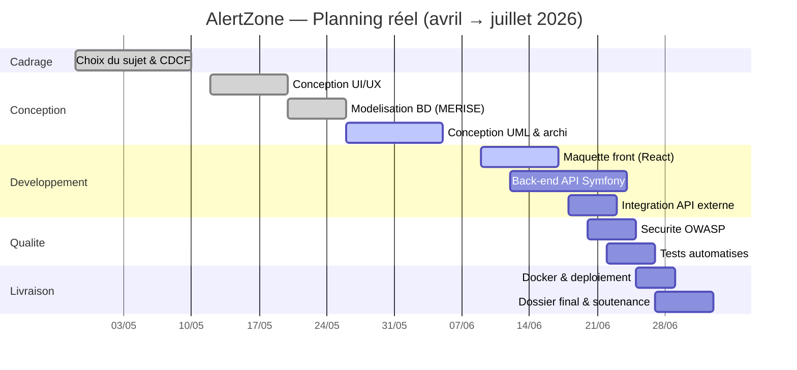
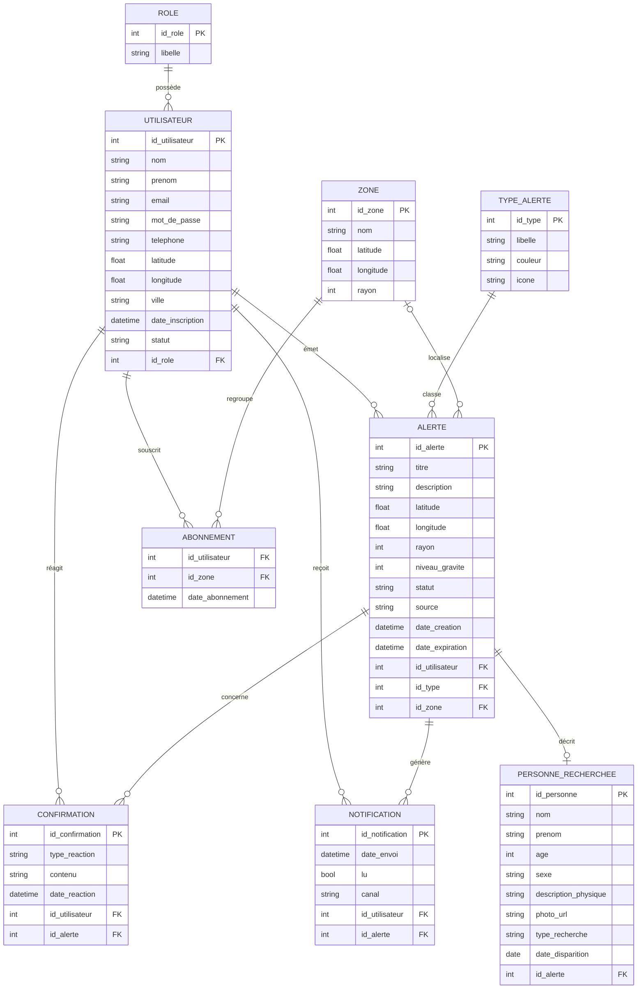
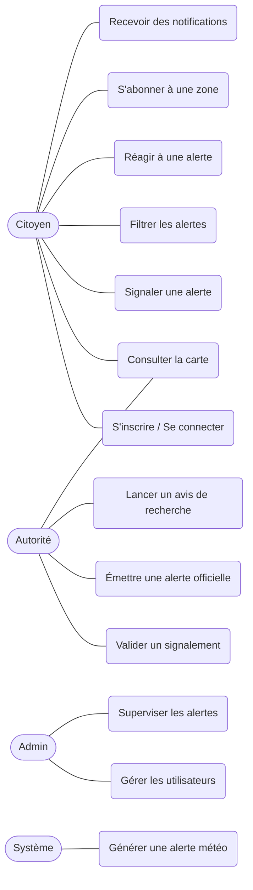
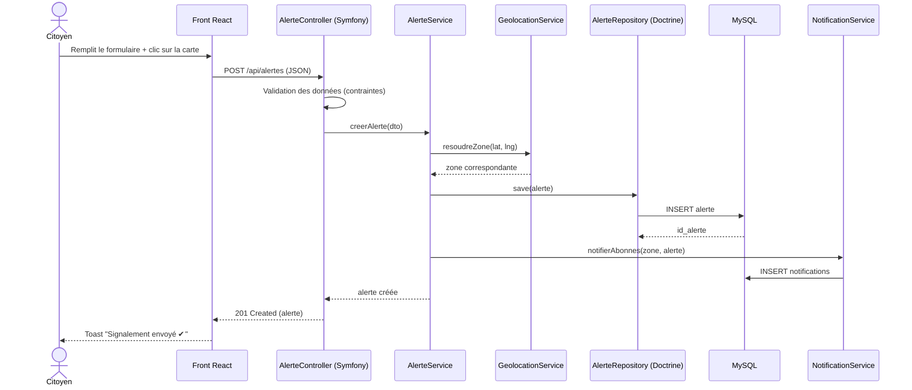
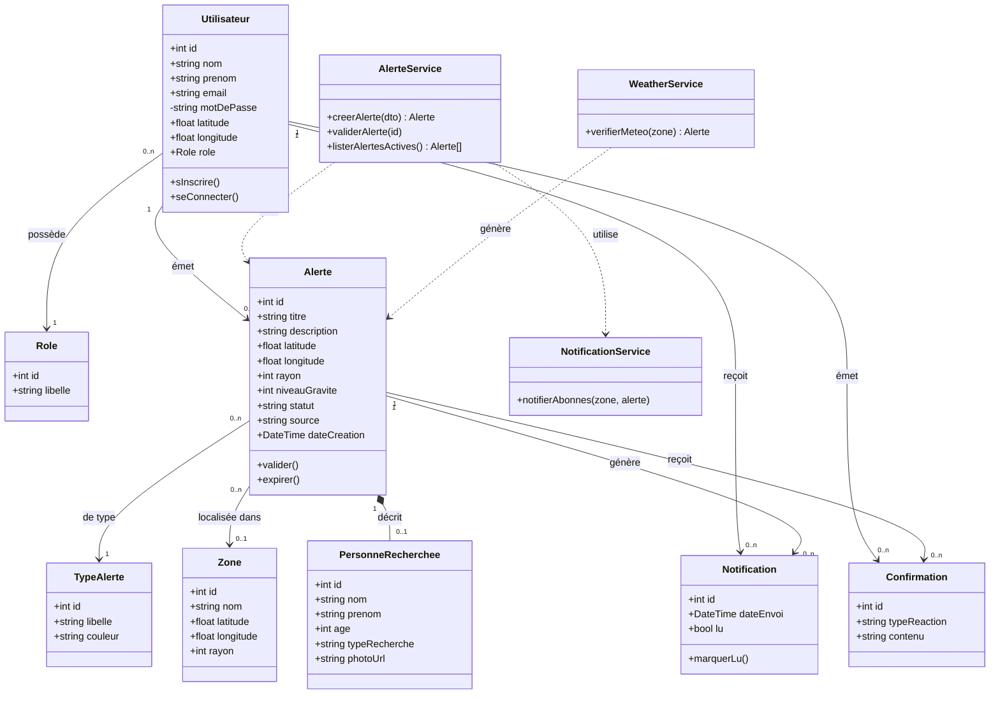
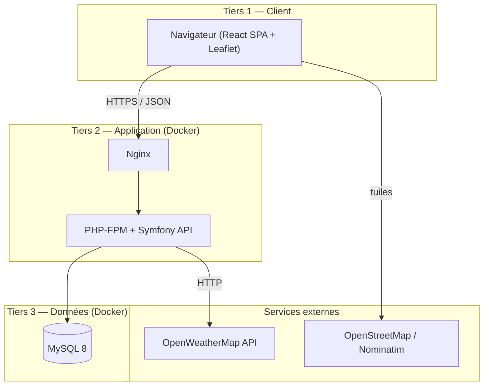

# Dossier de Projet Fil Rouge — AlertZone
### Système d'alerte citoyen géolocalisé

**Auteur :** Alain-Patrick Gomas
**Formation :** Bachelor Concepteur Développeur d'Applications (CDA) — 3ᵉ année — IPSSI
**Période projet :** Avril 2026 → Juin 2026
**Document :** Dossier de conception et d'avancement (support entretien)

---

## Sommaire

- II. Présentation du projet
- III. Cahier des charges fonctionnel (CDCF)
- IV. Méthodologie et organisation
- V. Conception UI/UX
- VI. Modélisation de la base de données (MERISE)
- VII. Conception de l'application (UML)
- VIII. Architecture multi-couches
- IX. Sécurité
- X. Politique de tests
- XI. Déploiement et mise en production
- XII. État d'avancement (pour l'entretien)

---

## II. Présentation du projet

### Contexte et problématique

Aujourd'hui, lorsqu'un événement dangereux survient localement — une agression dans une rue, un cambriolage dans un quartier, une tempête, ou la disparition d'un enfant — l'information circule mal et lentement. Les habitants directement concernés sont souvent les derniers informés, alors qu'ils sont les premiers exposés. Les canaux existants (réseaux sociaux non vérifiés, bouche-à-oreille, alertes nationales trop larges) sont soit imprécis géographiquement, soit non fiables.

**Le problème à résoudre :** comment diffuser, en temps quasi réel et de façon ciblée, une alerte aux seules personnes présentes dans la zone géographique concernée, tout en gardant un niveau de fiabilité acceptable (modération, confirmation citoyenne) ?

### Solution développée

**AlertZone** est une application web qui permet :

- à un **citoyen** de signaler un incident géolocalisé et de recevoir les alertes des zones auxquelles il est abonné ;
- à une **autorité** (police municipale, mairie, protection civile) de valider les signalements et d'émettre des alertes officielles, dont les avis de recherche (enfant disparu, criminel recherché) ;
- au **système** d'enrichir automatiquement les alertes météo grâce à une API externe.

L'application affiche une **carte interactive** où chaque alerte apparaît sous forme de marqueur coloré selon son type, avec un rayon d'impact. L'utilisateur peut filtrer, consulter le détail, confirmer une alerte ou la signaler comme fausse.

### Technologies utilisées

| Couche | Technologie | Justification courte |
|---|---|---|
| Back-end | **Symfony 7 (PHP 8.2)** en API REST | Imposé par le socle ; robuste, sécurité native (CSRF, hachage, validation) |
| Front-end | **React 18 (Vite)** — SPA | Application grand public nécessitant une UX très réactive et une carte dynamique |
| Cartographie | **Leaflet + OpenStreetMap** | Gratuit, sans clé pour les tuiles, idéal pour le prototype |
| API externe | **OpenWeatherMap** (+ géocodage Nominatim) | Alertes météo automatiques + transformation adresse → coordonnées |
| Base de données | **MySQL 8 (InnoDB)** | SGBD relationnel imposé, ORM Doctrine |
| Conteneurisation | **Docker + Docker Compose** | Environnement uniforme dev/prod |
| CI/CD | **GitHub Actions** | Tests + build automatisés à chaque push |

> **Choix d'architecture retenu : API Symfony + front React séparé** (et non full-Symfony/Twig). Raison : AlertZone est une application temps réel orientée carte, avec beaucoup d'interactions client (filtres, marqueurs, mises à jour sans rechargement). Une SPA React offre une bien meilleure réactivité qu'un rendu serveur Twig. Le découplage permet aussi de réutiliser l'API plus tard pour une appli mobile.

---

## III. Cahier des charges fonctionnel (CDCF)

### Contexte métier

Le secteur concerné est celui de la **sécurité publique de proximité** et de la **gestion d'alertes citoyennes**. Les utilisateurs cibles sont :

- les **habitants** d'une ville/quartier souhaitant être prévenus des dangers locaux ;
- les **autorités locales** (police municipale, mairie, pompiers) ayant besoin de diffuser rapidement une information vérifiée à une population précise.

### Objectifs du projet (SMART)

1. **Permettre à tout citoyen inscrit de signaler un incident géolocalisé** en moins de 60 secondes (titre, type, position sur carte, description).
2. **Diffuser une alerte aux utilisateurs abonnés à la zone concernée** dès sa validation, via notification in-app.
3. **Offrir une carte interactive filtrable par type d'alerte** affichant les incidents actifs avec leur rayon d'impact.
4. **Intégrer automatiquement les alertes météo** d'une zone via une API externe (vigilance tempête, etc.).
5. **Donner aux autorités un outil de modération et d'émission d'avis de recherche** (enfant disparu, criminel) avec photo et signalement.
6. **Garantir la sécurité des données** (mots de passe hachés, conformité RGPD, protection OWASP) avec 0 faille critique sur les tests de sécurité de base.

### Périmètre fonctionnel (exigences fonctionnelles)

**F1 — Gestion des comptes et des rôles**
Inscription, connexion, déconnexion, profil utilisateur. Trois rôles : `CITOYEN`, `AUTORITE`, `ADMIN`.

**F2 — Carte interactive des alertes**
Affichage des alertes actives sur une carte (Leaflet), marqueurs colorés par type, rayon d'impact, centrage sur la position de l'utilisateur.

**F3 — Signalement d'une alerte**
Un citoyen crée un signalement : type, titre, description, position (clic sur carte ou géolocalisation), niveau de gravité. Statut initial : *en attente*.

**F4 — Filtrage et recherche**
Filtrer les alertes par type (agression, vol, météo, disparition, recherche), par statut, par proximité.

**F5 — Réactions citoyennes**
Confirmer une alerte, la signaler comme « fausse alerte », ou ajouter un commentaire. Sert à fiabiliser l'information.

**F6 — Abonnement aux zones**
S'abonner à une ou plusieurs zones géographiques pour recevoir leurs alertes.

**F7 — Notifications**
Réception in-app des alertes des zones abonnées, marquage lu/non-lu.

**F8 — Modération (rôle Autorité)**
Valider ou rejeter les signalements citoyens, émettre des alertes officielles.

**F9 — Avis de recherche (rôle Autorité)**
Créer une alerte de type *personne disparue* ou *avis de recherche* avec photo, identité, description physique, date de disparition.

**F10 — Alertes météo automatiques (système)**
Le système interroge OpenWeatherMap et crée automatiquement une alerte météo en cas de vigilance sur une zone.

**F11 — Administration (rôle Admin)**
Gestion des utilisateurs (suspension), supervision globale des alertes, gestion des zones et des types d'alerte.

**Hors scope (cadrage)** : application mobile native, envoi réel de SMS/push, paiement. Le projet reste une web app ; les notifications restent *in-app*.

### Exigences techniques (rappel du socle imposé)

- Architecture : **API Symfony + front React séparé** (option retenue, justifiée ci-dessus).
- Composants : PHP 8.2, Symfony 7, React 18, MySQL 8, Docker.
- Contraintes imposées : Docker, CI/CD, tests automatisés, sécurité OWASP, **au moins une API externe**.
- Qualité : code maintenable, conventions **PSR-12**, séparation des responsabilités, documentation.

### Contraintes, risques et critères de succès

**Contraintes temporelles :** projet introduit le **20 mars 2026**, démarrage effectif **fin avril** (changement de sujet). Échéance finale **fin juin 2026**. Délai réel très court → priorisation forte des fonctionnalités cœur (F1 à F5, F8, F9).

**Risques identifiés :**

| Risque | Probabilité | Mitigation |
|---|---|---|
| Délai court pour tout implémenter | Élevée | MVP priorisé (F1–F5), fonctions secondaires en option |
| Dépendance à l'API météo externe | Moyenne | Gestion d'erreur + mock si l'API tombe |
| Quota gratuit OpenWeatherMap dépassé | Faible | Cache des appels, hypothèse : volumes faibles en démo |

**Contraintes réglementaires :** manipulation de données personnelles (email, position) → conformité **RGPD** obligatoire. Les avis de recherche manipulent des données sensibles → traitement fictif/pédagogique, données de démonstration uniquement.

**Critères de succès :** F1 à F5 + F8/F9 implémentées et testées ; carte fonctionnelle ; API externe opérationnelle ; 0 faille OWASP critique ; application déployable via `docker-compose up`.

---

## IV. Méthodologie et organisation

### 4.a Gestion de projet

**Méthode retenue : Agile Kanban adapté au travail en solo.**
Le projet étant individuel et le délai court, une approche Kanban est plus pragmatique que Scrum complet : un flux continu de tâches (À faire / En cours / Terminé) sans cérémonies lourdes. Je tiens un **tableau GitHub Projects** et un **journal de bord** hebdomadaire qui simule la revue de sprint.

**Planning réel (rattrapage).** Compte tenu du démarrage tardif, le planning est resserré :



### 4.b Versioning (Git)

Stratégie **GitFlow simplifié** :

- `main` : versions stables livrées (tags `v0.x`, puis `v1.0`).
- `develop` : intégration continue des fonctionnalités.
- `feature/*` : une branche par fonctionnalité (`feature/carte-alertes`, `feature/signalement`, `feature/auth`…), fusionnée via Pull Request une fois testée.

Commits fréquents, messages explicites (convention : `feat:`, `fix:`, `docs:`, `test:`). Les fichiers de config (Docker, CI) sont versionnés. Un `README.md` documente l'installation.

### 4.c DevOps — CI/CD

**Intégration continue (GitHub Actions).** À chaque push sur `develop` :
1. installation des dépendances (Composer + npm) ;
2. lint (PHP-CS-Fixer / ESLint) ;
3. exécution des tests (PHPUnit côté API, Vitest côté front).

**Déploiement continu (cible).** Sur push de tag sur `main` : build de l'image Docker → push sur Docker Hub → procédure de déploiement (`docker-compose up -d`). En contexte pédagogique, une **procédure manuelle documentée** suffit si pas de serveur cible.

---

## V. Conception UI/UX

### 5.a Zoning / Arborescence

Structure type d'un écran (vue cartographique principale) :

```
+--------------------------------------------------+
|  HEADER : logo AlertZone | recherche | profil    |
+----------------+---------------------------------+
|  PANNEAU       |                                 |
|  LATERAL       |        CARTE INTERACTIVE         |
|  - filtres     |        (marqueurs + zones)       |
|  - liste des   |                                 |
|    alertes     |   [bouton flottant : Signaler]  |
+----------------+---------------------------------+
|  FOOTER : mentions legales | RGPD | a propos      |
+--------------------------------------------------+
```

**Plan de site :** Accueil/Carte → Détail alerte → Signaler une alerte → Mes notifications → Profil → (Autorité) Modération → (Admin) Administration.

### 5.b Wireframes

Écrans clés à maquetter (basse fidélité, fournis en annexe / Figma) : Carte principale, Détail d'une alerte, Formulaire de signalement, Notifications, Connexion/Inscription, Tableau de modération. Versions desktop **et** mobile (l'interface mobile passe la carte en plein écran avec filtres en bottom-sheet).

### 5.c Charte graphique

Le thème évoque la **sécurité, la confiance et l'urgence maîtrisée**.

| Élément | Valeur | Usage |
|---|---|---|
| Bleu principal | `#1E3A8A` | Header, boutons primaires, identité |
| Rouge alerte | `#DC2626` | Urgences, agressions, boutons critiques |
| Ambre | `#F59E0B` | Météo / vigilance |
| Vert | `#16A34A` | Alerte résolue / état sûr |
| Violet | `#7C3AED` | Personne disparue / avis de recherche |
| Gris ardoise clair | `#F8FAFC` | Fond général |
| Gris foncé | `#1E293B` | Textes |
| Police titres | **Inter / Poppins** (gras) | Hiérarchie forte |
| Police texte | **Inter** | Lisibilité |

**Couleurs par type d'alerte** (cohérence carte ↔ filtres) :
Agression = rouge `#DC2626` · Vol = orange `#EA580C` · Tempête/Météo = ambre `#F59E0B` · Personne disparue = violet `#7C3AED` · Avis de recherche = bordeaux `#991B1B`.

### 5.d Considérations UX

Approche **Mobile First**, retours visuels clairs (toasts de confirmation/erreur), accessibilité (contrastes AA, libellés explicites). Le geste central — « signaler » — est accessible en un clic depuis n'importe quel écran via un bouton flottant.

---

## VI. Modélisation de la base de données (MERISE)

### 6.a Introduction à la méthode

Conformément à MERISE, la modélisation suit trois étapes : **MCD** (conceptuel, indépendant de la technique), **MLD** (logique/relationnel) puis **MPD** (physique, propre à MySQL). Cette progression garantit une base normalisée (3ᵉ forme normale) et adaptée aux opérations de l'application.

### 6.b Dictionnaire des données (extrait)

| Donnée | Entité | Type | Description |
|---|---|---|---|
| id_utilisateur | UTILISATEUR | entier | Identifiant unique |
| email | UTILISATEUR | texte (unique) | Identifiant de connexion |
| mot_de_passe | UTILISATEUR | texte | Haché (bcrypt/argon2), jamais en clair |
| latitude / longitude | UTILISATEUR, ALERTE | décimal | Coordonnées géographiques |
| libelle (role) | ROLE | texte | CITOYEN / AUTORITE / ADMIN |
| titre | ALERTE | texte | Intitulé de l'alerte |
| niveau_gravite | ALERTE | entier (1–5) | Échelle de gravité |
| statut | ALERTE | énum | EN_ATTENTE / VALIDEE / REJETEE / EXPIREE / RESOLUE |
| source | ALERTE | énum | CITOYEN / AUTORITE |
| rayon | ALERTE, ZONE | entier (m) | Rayon d'impact en mètres |
| libelle (type) | TYPE_ALERTE | texte | Agression, Vol, Météo, Disparition, Recherche |
| type_recherche | PERSONNE_RECHERCHEE | énum | ENFANT_DISPARU / CRIMINEL_RECHERCHE |
| lu | NOTIFICATION | booléen | Notification lue ou non |
| type_reaction | CONFIRMATION | énum | CONFIRME / FAUSSE_ALERTE / COMMENTAIRE |

### 6.c Modèle Conceptuel de Données (MCD)

Diagramme entité-association (voir aussi `mcd_alertzone.mermaid`) :



**Lecture des cardinalités MERISE (à savoir expliquer à l'oral) :**
- Un **UTILISATEUR** possède **1,1** rôle ; un **ROLE** est porté par **0,n** utilisateurs.
- Une **ALERTE** est émise par **1,1** utilisateur et est d'**1,1** type ; un utilisateur émet **0,n** alertes.
- Une **ALERTE** est localisée par **0,1** zone (optionnel) ; une zone localise **0,n** alertes.
- Une **PERSONNE_RECHERCHEE** est décrite par **1,1** alerte ; une alerte décrit **0,1** personne (uniquement pour les types disparition/recherche).
- **NOTIFICATION**, **CONFIRMATION** et **ABONNEMENT** sont des **entités associatives** matérialisant des relations *plusieurs-à-plusieurs* entre UTILISATEUR et ALERTE/ZONE, porteuses d'attributs propres.

### 6.d Modèle Logique de Données (MLD)

```
ROLE (id_role, libelle)
UTILISATEUR (id_utilisateur, nom, prenom, email, mot_de_passe, telephone,
             latitude, longitude, ville, date_inscription, statut, #id_role)
TYPE_ALERTE (id_type, libelle, couleur, icone)
ZONE (id_zone, nom, latitude, longitude, rayon)
ALERTE (id_alerte, titre, description, latitude, longitude, rayon, niveau_gravite,
        statut, source, date_creation, date_expiration,
        #id_utilisateur, #id_type, #id_zone)
PERSONNE_RECHERCHEE (id_personne, nom, prenom, age, sexe, description_physique,
                     photo_url, type_recherche, date_disparition, #id_alerte)
NOTIFICATION (id_notification, date_envoi, lu, canal, #id_utilisateur, #id_alerte)
CONFIRMATION (id_confirmation, type_reaction, contenu, date_reaction,
              #id_utilisateur, #id_alerte)
ABONNEMENT (#id_utilisateur, #id_zone, date_abonnement)
```
*Clés primaires soulignées dans l'original ; `#` = clé étrangère. La table ABONNEMENT a une clé primaire composée (id_utilisateur, id_zone).*

### 6.e Modèle Physique de Données (MPD) — MySQL 8 / InnoDB (extrait)

```sql
CREATE TABLE role (
    id_role     INT AUTO_INCREMENT PRIMARY KEY,
    libelle     VARCHAR(50) NOT NULL UNIQUE
) ENGINE=InnoDB;

CREATE TABLE utilisateur (
    id_utilisateur  INT AUTO_INCREMENT PRIMARY KEY,
    nom             VARCHAR(100) NOT NULL,
    prenom          VARCHAR(100) NOT NULL,
    email           VARCHAR(180) NOT NULL UNIQUE,
    mot_de_passe    VARCHAR(255) NOT NULL,
    telephone       VARCHAR(20),
    latitude        DECIMAL(10,7),
    longitude       DECIMAL(10,7),
    ville           VARCHAR(100),
    date_inscription DATETIME NOT NULL DEFAULT CURRENT_TIMESTAMP,
    statut          ENUM('ACTIF','SUSPENDU') NOT NULL DEFAULT 'ACTIF',
    id_role         INT NOT NULL,
    CONSTRAINT fk_user_role FOREIGN KEY (id_role) REFERENCES role(id_role)
) ENGINE=InnoDB;

CREATE TABLE type_alerte (
    id_type   INT AUTO_INCREMENT PRIMARY KEY,
    libelle   VARCHAR(80) NOT NULL,
    couleur   VARCHAR(7)  NOT NULL,
    icone     VARCHAR(50)
) ENGINE=InnoDB;

CREATE TABLE alerte (
    id_alerte       INT AUTO_INCREMENT PRIMARY KEY,
    titre           VARCHAR(150) NOT NULL,
    description     TEXT,
    latitude        DECIMAL(10,7) NOT NULL,
    longitude       DECIMAL(10,7) NOT NULL,
    rayon           INT NOT NULL DEFAULT 500,
    niveau_gravite  TINYINT NOT NULL DEFAULT 1,
    statut          ENUM('EN_ATTENTE','VALIDEE','REJETEE','EXPIREE','RESOLUE')
                    NOT NULL DEFAULT 'EN_ATTENTE',
    source          ENUM('CITOYEN','AUTORITE') NOT NULL DEFAULT 'CITOYEN',
    date_creation   DATETIME NOT NULL DEFAULT CURRENT_TIMESTAMP,
    date_expiration DATETIME,
    id_utilisateur  INT NOT NULL,
    id_type         INT NOT NULL,
    id_zone         INT,
    CONSTRAINT fk_alerte_user FOREIGN KEY (id_utilisateur) REFERENCES utilisateur(id_utilisateur),
    CONSTRAINT fk_alerte_type FOREIGN KEY (id_type) REFERENCES type_alerte(id_type),
    INDEX idx_statut (statut),
    INDEX idx_geo (latitude, longitude)
) ENGINE=InnoDB;
```
*(Les tables `zone`, `personne_recherchee`, `notification`, `confirmation`, `abonnement` suivent le même principe.)*

### Justification de la modélisation

Le modèle est en **3ᵉ forme normale** : aucune redondance, chaque donnée a une place logique unique. Les types d'alerte et les rôles sont externalisés en tables de référence (évite la redondance de libellés). Les relations N-N (notifications, réactions, abonnements) passent par des tables d'association porteuses d'attributs (date, état lu, type de réaction), ce qui respecte les bonnes pratiques relationnelles.

---

## VII. Conception de l'application (UML)

### Diagramme de cas d'utilisation

(Voir `use_case_alertzone.mermaid`.) Les acteurs sont **Citoyen**, **Autorité**, **Admin** et le **Système** (déclencheur des alertes météo). Chaque fonctionnalité du CDCF est couverte par au moins un cas d'utilisation.



### Diagramme de séquence — « Signaler une alerte »

(Voir `sequence_signalement.mermaid`.) Illustre le découpage en couches front → API → service → ORM → BD, puis la notification des abonnés de la zone.



### Diagramme de classes

(Voir `class_alertzone.mermaid`.) Classes métier (entités) + classes de service (logique applicative) + contrôleurs.



**Composition vs agrégation (à savoir défendre) :** `Alerte *-- PersonneRecherchee` est une **composition** (la personne recherchée n'existe que dans le cadre d'une alerte ; si l'alerte est supprimée, la fiche disparaît). `Alerte --> Zone` est une **association** simple (la zone existe indépendamment de l'alerte).

---

## VIII. Architecture multi-couches

### Modèle MVC (couche logique)

AlertZone applique le pattern MVC côté Symfony :
- **Contrôleurs** (`src/Controller`) : reçoivent les requêtes HTTP de l'API, valident, renvoient du JSON.
- **Services** (`src/Service`) : logique métier (AlerteService, NotificationService, WeatherService). Le contrôleur ne contient aucune règle métier.
- **Modèles** : entités Doctrine (`src/Entity`) + repositories (`src/Repository`) pour l'accès aux données.
- **Vue** : côté React (la SPA consomme le JSON et gère l'affichage). Pas de Twig dans l'option API.

### Architecture n-tiers (tiers physique)



**Distinction couche logique / tiers physique (piège classique du jury) :** les trois couches logiques (présentation, métier, données) peuvent tourner sur un même hôte physique. Ici, Docker Compose orchestre des conteneurs séparés (front, api, db) qui pourraient être répartis sur plusieurs serveurs en production — mais l'architecture reste une **3-tiers logique** quoi qu'il arrive.

### Séparation des responsabilités

Respect du principe **SRP** (Single Responsibility) : chaque service a une responsabilité unique. Configuration sensible isolée dans des fichiers `.env` (jamais commitée). Conventions **PSR-12** côté PHP, ESLint côté React. Code DRY/KISS.

---

## IX. Sécurité

| Faille OWASP | Mesure mise en place dans AlertZone |
|---|---|
| **Injection SQL** | Doctrine ORM + requêtes paramétrées exclusivement ; aucune concaténation d'entrée utilisateur dans une requête. |
| **XSS** | React échappe par défaut le contenu rendu ; côté API, validation/échappement des entrées. Aucune insertion de HTML brut non filtré. |
| **CSRF** | Tokens CSRF Symfony sur les actions sensibles ; côté API REST, authentification par **JWT** + vérification de l'origine. |
| **Authentification** | Mots de passe hachés en **bcrypt/argon2** (`password_hash` / hasher Symfony) ; jamais stockés en clair. |
| **Force brute** | Limitation des tentatives de connexion via le composant **Rate Limiter** de Symfony (temporisation après X échecs). |
| **RGPD** | L'utilisateur peut supprimer son compte et ses données ; politique de confidentialité dans l'app ; données de démo uniquement ; HTTPS en production. |
| **Contrôle d'accès** | Rôles Symfony (`ROLE_CITOYEN`, `ROLE_AUTORITE`, `ROLE_ADMIN`) ; un citoyen ne peut pas accéder aux écrans de modération/admin. |
| **Validation des entrées** | Contraintes de validation Symfony sur les entités (formats, longueurs, types). |

---

## X. Politique de tests

**10.a Tests unitaires** — PHPUnit sur la logique métier (ex. : `AlerteService::creerAlerte` renvoie bien un statut `EN_ATTENTE` ; calcul de la distance entre deux points pour déterminer la zone d'impact).

**10.b Tests fonctionnels** — Tests d'API Symfony (WebTestCase) : `POST /api/alertes` renvoie `201`, `GET /api/alertes` renvoie la liste filtrée. Côté front, tests de composants avec **Vitest + React Testing Library** (le filtre masque bien les marqueurs du type décoché).

**10.c Autres tests** — Test d'intégration de l'appel réel à OpenWeatherMap (avec gestion d'erreur si l'API ne répond pas). Test de performance simple : temps de chargement de la carte avec 100 alertes < 2 s.

**Outils :** PHPUnit, Vitest, exécutés en local et dans la CI GitHub Actions.

---

## XI. Déploiement et mise en production

**Containerisation Docker.** `docker-compose.yml` orchestrant trois services : `front` (Nginx servant le build React), `api` (PHP-FPM + Symfony), `db` (MySQL avec volume persistant et dump initial des données de référence : rôles, types d'alerte).

**Lancement (une commande) :**
```bash
docker-compose up -d
```
Application accessible sur `http://localhost:8080` (front) et `http://localhost:8000/api` (API).

**Environnements.** `APP_ENV=dev` (debug activé) en local, `APP_ENV=prod` (debug désactivé, cache optimisé) en production. Secrets (clé API météo, mot de passe BD, secret JWT) injectés via variables d'environnement, jamais en dur.

**Stratégie de mise en production (théorique).** Déploiement **blue/green** : la nouvelle version est déployée en parallèle puis le routage bascule une fois validée, ce qui évite toute interruption. En contexte pédagogique, un déploiement manuel pendant une fenêtre de maintenance suffit.

---

## XII. État d'avancement (pour l'entretien)

**Réalisé à ce jour :**
- ✅ Sujet cadré et CDCF rédigé (objectifs, périmètre, risques).
- ✅ Méthodologie et planning de rattrapage définis (Kanban + GitHub Projects).
- ✅ Conception UI/UX : zoning, charte graphique, écrans clés identifiés.
- ✅ Modélisation BD complète MERISE (MCD, MLD, MPD).
- ✅ Conception UML : cas d'utilisation, séquence, diagramme de classes.
- ✅ Architecture multi-couches définie (MVC + 3-tiers Docker).
- 🔄 Démarrage du développement : **maquette front React** (carte, filtres, signalement) en cours.

**Prochaines étapes (juin) :**
- Finaliser la maquette front et la connecter à l'API.
- Développer l'API Symfony (entités Doctrine générées depuis le MPD, endpoints CRUD alertes, auth JWT).
- Intégrer OpenWeatherMap.
- Sécurité OWASP + tests automatisés + CI.
- Dockerisation finale + dossier final + soutenance.

**Argument clé pour l'entretien :** malgré un démarrage tardif (changement de sujet fin avril), **toute la phase de conception est terminée et documentée**, et le développement est amorcé. Le risque principal — le délai — est explicitement géré par une priorisation MVP des fonctionnalités cœur.
